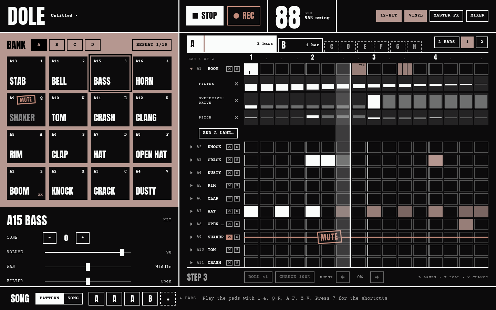

# Dole



Dole is a sampler and sequencer that works like an MPC. It has sixteen pads
you play with your fingers or the keyboard, with your hits recording into the
pattern as it loops. You can chop a record onto the pads and pitch the chops
down, and patterns chain into a song that exports to WAV. It's made for
boom-bap: a lazy swing, a dusty kit, and an eerie loop.

- **Pads.** Sixteen pads in a 4×4 grid, pad 1 at the bottom left, in four
  banks, A to D: 64 tracks. Play them on a touch screen (several at once) or
  with the keys `1 2 3 4`, `Q W E R`, `A S D F`, `Z X C V`, which go by where
  the key sits on any layout. Shift hits harder. Bank A holds the kit; B to
  D start empty, for your samples and synths.
- **Record.** Shift+Space (or Rec) starts the loop and records what you play
  onto the nearest sixteenth. A whole take undoes as one.
- **Note repeat.** Turn it on with N and hold a pad to roll it at 1/8, 1/16,
  1/32, or triplets (Shift+N, or a long press on Repeat).
- **The kit.** Two kicks (boom and knock), two snares (crack and dusty), a
  rim, a clap, closed and open hats, a shaker, a tom, a crash, a sword clang,
  a minor piano stab, a bell, a sub bass on C2, and a horn stab. The hats
  share a mute group, so the closed one cuts the open one off.
- **Samples and chops.** Load any sample onto a pad (WAV, FLAC, MP3, anything
  `ffmpeg` reads). Or press K to chop one: Dole slices it where it hits (or
  into 4, 8, or 16 even pieces), you tap the slices to hear them, and then lay
  them out on the pads. Tune each pad up or down by up to two octaves. As on
  an MPC, pitch and speed change together, so a soul loop tuned down drags
  and darkens. Basslines come from copies of a pad, each tuned to a note.
- **Grit.** G steps the master through Clean, 12-bit (an SP-1200's 26 kHz and
  12 bits), and Crushed. Shift+G adds vinyl crackle. Both are in the export.
- **Swing** goes from straight to 75%. The demo loop sits at 58%. A track
  can have its own.
- **Tracks.** Each has a volume, pan, a filter that closes as a low-pass or
  opens as a high-pass, with resonance, an attack and decay to shape each
  hit, reverse, a gate that cuts a sample off after its length or when the
  pad is let go, a choke group, its own swing, and its own loop length, so
  a three-step hat runs against the bar.
- **Steps.** A pattern is one to four bars. A step can roll two to four hits,
  play only some of the time, or sit early or late of the grid.
- **Lanes.** Open a track (L, or the ▸ beside it) and give it lanes: its
  pitch, volume, pan, filter, resonance, or decay, or any parameter of its
  synth and effects, set step by step. Draw them with a finger or the mouse.
  A pitch lane bends a long sample as it plays, like a tape.
- **Mixer.** Every track of a bank side by side, with a fader, pan, meter,
  mute, solo, and its effects, and the mix's meter beside them.
- **Plugins.** Any pad can play a CLAP or LV2 synth instead of a sample. Its
  steps play notes, its tune sets the note, and a length holds it for up to a
  bar. Every pad, and the master, has a chain of up to four effects. Those
  can be plugins, or dole's own, made for noise: overdrive with a fuzz that
  rectifies, a bitcrusher, a ring modulator, a metal comb resonator, a dirty
  delay whose feedback runs past 100%, and a tempo-synced stutter. Press J
  for the pad's chain (Shift+J for the master): every control is a slider,
  with a search for synths that have hundreds, and a CLAP plugin's own
  window opens over dole through XWayland.
  Plugins are found in `~/.clap`, `/usr/lib/clap`, `~/.lv2`, and
  `/usr/lib/lv2`. `omarchy-pkg-add surge-xt-clap lsp-plugins-clap guitarix` is a
  good start.

Dole follows the Omarchy theme and language.

```
dole open [song.dole]
```

## Shortcuts

| Keys | Action |
| --- | --- |
| 1–4, Q–R, A–F, Z–V | Play the pads; with Shift, harder |
| Space | Play or stop |
| Shift+Space | Record the pads into the pattern |
| N, Shift+N | Note repeat on or off, and its timing |
| P | Play the pattern being edited, or the song |
| [ ] and { } | Tempo down or up, by 1 or 10 |
| , . | Less or more swing |
| G, Shift+G | Grit, and vinyl |
| ← → ↑ ↓ | Move between steps and pads |
| Ctrl+← → | The bar before or after |
| Enter | Turn a step on or off |
| Delete | Clear a step, or a lane's value |
| Shift+↑ ↓ | A step louder or softer, or a lane's value up or down |
| T, Y | A step's roll, and its chance |
| Alt+← → | Nudge a step early or late |
| B, Shift+B | The next or the previous bank |
| L, Shift+L | Open the track to its lanes, or add a lane |
| - = and _ + | Tune the pad by a semitone or an octave |
| Shift+← → | Pad volume |
| M, Shift+M | Mute or solo the pad |
| U | The pad's choke group |
| O, Shift+O | Load a sample onto the pad, or go back to the kit |
| K | Chop a sample onto the pads |
| J, Shift+J | The pad's synth and effects, or the master's |
| Ctrl+1 – 8, PgUp, PgDn | Edit pattern A to H (it takes over at the next bar) |
| Ctrl+B | Make the pattern one to four bars |
| Ctrl+M | The mixer |
| Ctrl+C, Ctrl+V | Copy and paste a pattern |
| Ctrl+Delete | Clear the pattern |
| Tab | Switch between the steps and the song |
| Ctrl+1 – 8 (song) | Set the slot, or add one at the end |
| I, Delete (song) | Insert or remove a slot |
| Enter (song) | Edit the slot's pattern |
| Ctrl+Z, Ctrl+Shift+Z | Undo or redo |
| Ctrl+N, Ctrl+O | New or open a song |
| Ctrl+S, Ctrl+Shift+S | Save, or save as |
| Ctrl+E | Export the song as WAV |
| ? | Show or hide the shortcuts |
| Ctrl+Q | Quit |

In the chop view, ← → step through the slices and play each one, and Enter
lays them out on the pads, starting from the pad that's selected.

## Songs are text

A song is a small JSON file that you, a script, or an agent can write:

```json
{
  "dole": 3, "bpm": 88, "swing": 58, "grit": "12-bit", "vinyl": true,
  "pads": { "B1": { "sample": "soul.wav", "start": 1.25, "end": 1.9, "tune": -3, "filter": -0.3 } },
  "patterns": {
    "A": {
      "1": "X......x..x.....",
      "3": "....X.......X...",
      "7": { "steps": "x.o.x.o.x.o.x.oo", "roll": { "16": 3 } },
      "B1": { "steps": "x.......x.......", "lanes": { "pitch": { "1": 0, "9": -5 } } }
    }
  },
  "song": ["A", "A", "A", "B"]
}
```

`dole help format` describes the whole format. These commands need no display;
each takes `--json` and exits 0 or 1:

| Command | |
| --- | --- |
| `dole new song.dole` | Start a song from the demo loop (`--empty` for none) |
| `dole check song.dole` | Report every problem, and the tempo, patterns, and length |
| `dole render song.dole -o song.wav` | Render the song (`--pattern B --bars 4` for one pattern) |
| `dole plugins` | List the synths and effects that can be loaded |
| `dole skill install` | Install the agent skill for Claude Code and Codex |

## Building

Dole uses Qt 6 (base, declarative, multimedia, svg, wayland), `ffmpeg`,
`lilv` for LV2, and `libxcb` (with RandR) for plugin windows, all of which come with
Omarchy. The CLAP headers (MIT) are in `third_party/clap`.

```
bin/build                                # build into build/
bin/test                                 # build, then run the tests offscreen
cmake --install build --prefix ~/.local  # add it to the app launcher
```

## License

MIT. The CLAP headers in `third_party/clap` are MIT, by Alexandre Bique and
the CLAP authors. The faces compiled into the window, Anton (by Vernon Adams)
and Courier Prime (by Alan Dague-Greene), are under the SIL Open Font License;
their licenses are in `src/fonts`. The theme, translator, file picker, command line, and dialog buttons
follow Omacut, Hype, and the other Omarchy apps by David Heinemeier Hansson.
